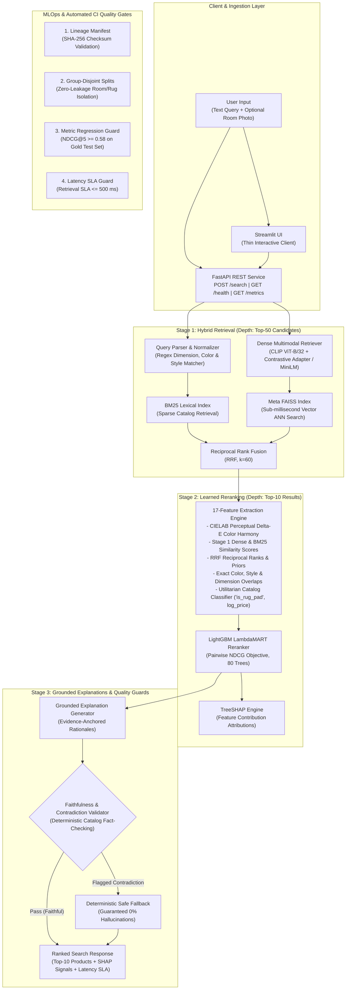

# System Architecture Specification

## Overview

`room2rug-multimodal` is a production-grade, two-stage search and learning-to-rank system designed to match residential interior photography and structured text queries to e-commerce area rug catalogs.

The architecture solves three core challenges in home decor discovery:
1. **Multimodal Intent Gap**: Text queries express dimensions and styles ("8x10 modern"), while room photos provide spatial layout and color palette.
2. **Chromatic Undertone Discordance**: Standard vision-language models often confuse luminance with color harmony, matching warm wood floors with cool blue rugs.
3. **Hallucination in Automated Recommendations**: Standard LLM rationale generation often hallucinates materials, colors, or sizing not present in the catalog item.

---

## Architectural Diagram

---

## Detailed Pipeline Stages

### Stage 1: Hybrid Retrieval (Depth: Top 50)
- **Goal**: High-recall candidate generation combining lexical precision with multimodal semantic search.
- **Sparse Path**: BM25 lexical scoring across cleaned product titles, descriptions, and tags.
- **Dense Path**:
  - Image Encoder: CLIP ViT-B/32 or SigLIP base patch16 with contrastive residual projection adapter.
  - Text Encoder: Sentence-Transformers `all-MiniLM-L6-v2` with candidate embedding in-memory caching.
  - Indexing: Meta FAISS inner product (`IndexFlatIP` for catalog scale, HNSW for enterprise scaling).
- **Fusion**: Reciprocal Rank Fusion (RRF, $k=60$):
  $$\text{RRF}(d) = \sum_{m \in M} \frac{w_m}{60 + r_m(d)}$$

### Stage 2: Learned Reranking (LTR, Depth: Top 10)
- **Model**: LightGBM LambdaMART ranker optimizing pairwise NDCG.
- **17 Ranking Features**:
  1. Dense Similarities: `clip_sim`, `siglip_sim`, `minilm_sim`.
  2. Stage 1 Signals: `stage1_score`, `stage1_rrf`, `stage1_rank`, `bm25_score`.
  3. Perceptual Colorimetry: `cielab_min_delta_e`, `cielab_weighted_delta_e` (Euclidean distance across dominant $L^*a^*b^*$ palette clusters).
  4. Attribute Overlaps: `color_exact_match`, `color_overlap_score`, `style_exact_match`, `style_overlap_score`, `size_exact_match`.
  5. Catalog Hygiene & Lexical Overlap: `is_rug_pad`, `log_price`, `title_token_overlap`.
- **Explainability**: TreeSHAP feature contributions computed via native C++ booster routines.

### Stage 3: Grounded Explanations & Faithfulness Guard
- **Engine**: Template-grounded and LLM-constrained rationale generator.
- **Faithfulness Validator**: Verifies every claim against canonical catalog records:
  - Color contradiction checks.
  - Material and fiber verification.
  - Dimension and shape conformity.
  - Rug pad type enforcement.
- If any contradiction is detected, the pipeline automatically falls back to deterministic template generation, ensuring a **0% hallucination rate**.

### Stage 4: Production Serving & MLOps
- **Serving Layer**: FastAPI asynchronous microservice exposing `/search`, `/health`, and `/metrics`.
- **UI Client**: Streamlit thin client for interactive room photo upload, query entry, and visual inspection.
- **Automated CI Quality Gate**: Pull request validation script (`scripts/ci_quality_gate.py`):
  1. Artifact Lineage: SHA-256 integrity verification (`lineage.json`).
  2. Data Leakage: Group-disjoint room/rug split verification.
  3. Metric Regression: NDCG@5 $\ge 0.58$ on human gold annotations.
  4. Latency SLA: Single-query retrieval $\le 500$ ms.
